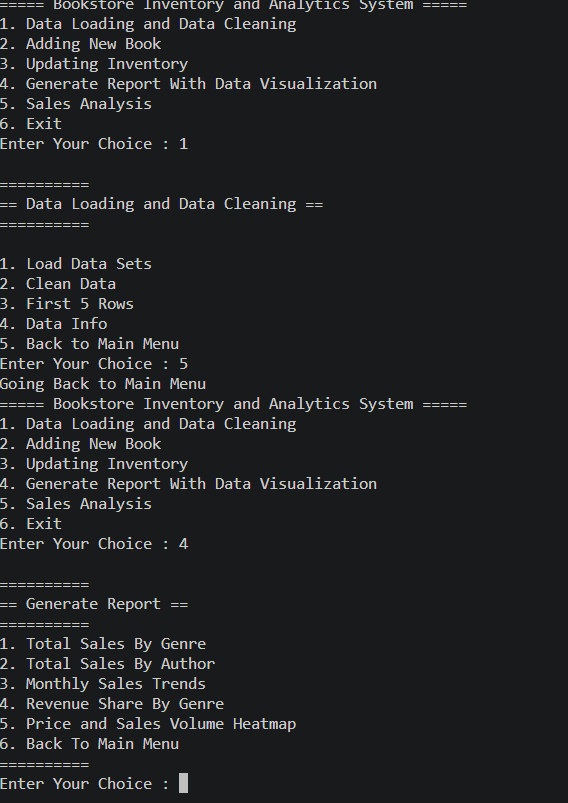

# Python OOP Project: Bookstore Inventory and Analytics System

## Author

**Your Name**

---

## 📌 Project Overview

The **Bookstore Inventory and Analytics System** is a console-based Python project that manages a bookstore's inventory and analyzes its sales data using **Object-Oriented Programming (OOP)** and data analysis libraries.

The project allows users to:

- Load and clean inventory and sales datasets
- Add new books to the inventory
- Update the quantity of existing books
- Generate reports with data visualizations
- Perform sales analysis

All functionality is organized inside a single `Bookstore` class, and data is stored in CSV files.

---

## 🎯 Project Objectives

The main objectives of this project are:

- Create and use classes and objects.
- Understand constructors (`__init__`).
- Organize program logic into class methods.
- Create a menu-driven console application.
- Accept and process user input.
- Handle errors using `try` and `except`.
- Read and write CSV files using pandas.
- Clean data (check, fill, or drop missing values).
- Merge, group, and summarize datasets.
- Visualize data using charts.

---

## 🛠️ Technologies Used

- **Programming Language:** Python
- **Programming Concept:** Object-Oriented Programming
- **Application Type:** Console / Terminal Application
- **External Libraries:**
  - pandas
  - numpy
  - matplotlib
  - seaborn

Install the required packages:

```bash
pip install pandas numpy matplotlib seaborn
```

---

## ✨ Features

- Classes and objects
- Constructors
- Menu-driven application
- Loops and conditional statements
- User input
- Exception handling
- CSV file reading and writing
- Data cleaning
- Data merging and grouping
- Data visualization

### 📊 Reports

- Total sales by genre (bar chart)
- Total sales by author (bar chart)
- Monthly sales trends (line chart)
- Revenue share by genre (pie chart)
- Price and sales volume correlation (heatmap)

### 📈 Sales Analysis

- Total revenue
- Top-selling books
- Sales trends by date
- Book with lowest sales

---

## 🗃️ Data Files

**inventory.csv**

| Title | Author | Genre | Price | Quantity |
|-------|--------|-------|-------|----------|

**sales.csv**

| Title | Quantity Sold | Total Revenue | Date |
|-------|---------------|---------------|------|

Notes:

- Titles in both files must match exactly.
- Titles added through the app are stored in lowercase, so use lowercase titles in `sales.csv`.

---

## ▶️ How to Run

```bash
python main.py
```

Start with **1. Data Loading and Data Cleaning → 1. Load Data Sets**, otherwise the other options will fail.

### Main Menu

```text
1. Data Loading and Data Cleaning
2. Adding New Book
3. Updating Inventory
4. Generate Report With Data Visualization
5. Sales Analysis
6. Exit
```

---

## 📂 Project Structure

The project consists of a Python program, data files, output screenshot, and README documentation.

```text
│
├── bookstore_system.py
├── inventory.csv
├── sales.csv
├── output.png
└── README.md
```

---


## Output



---
